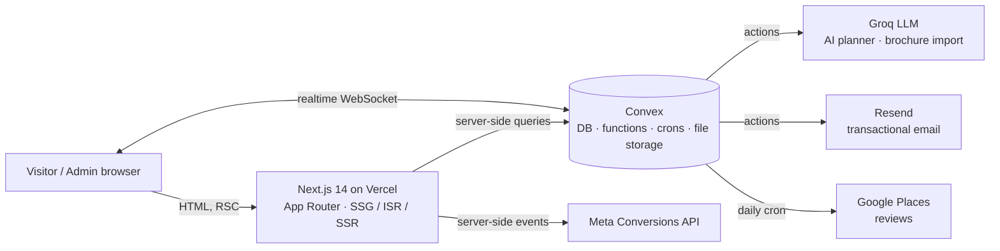

<div align="center">

# JunketTours

**A production travel-booking and operations platform for tours across Pakistan.**

[**Live site → junkettours.co**](https://www.junkettours.co)


</div>

---

JunketTours runs a real tour operator's business end to end. Travellers browse
tours, plan trips with an AI assistant, and book with or without an account.
The operations team runs everything else from a realtime admin panel: the tour
catalogue, bookings, leads, visa invitation letters, invoices, and branded
itinerary documents.

It is a live, client-facing product, not a demo. It handles real customer data
and real bookings, and the engineering choices below follow from that.

## At a glance

| | |
| --- | --- |
| **Pages** | 60 routes: 32 public, 28 admin |
| **Backend** | 206 typed Convex functions over a 28-table schema with 68 indexes |
| **Rendering** | 84 pages pre-rendered at build time; the rest server-rendered or incrementally revalidated |
| **Quality gates** | Strict TypeScript, ESLint, and backend regression tests, run in CI on every push |
| **Environments** | Separate dev and production databases, with deploy keys kept out of git |

## What it does

### For travellers
- **Tour catalogue**: detail pages with galleries, day-by-day itineraries, route maps, live pricing, and related tours.
- **Booking**: book as a guest (no account needed), or register to get a dashboard with booking history and a profile. Guest bookings link to the account if the traveller registers later.
- **AI trip planner**: a chat assistant that reads the *live* tour catalogue, suggests matching tours and an itinerary, keeps the conversation going for follow-ups, and turns the chat into a custom-quote request when nothing fits.
- **Currency**: prices shown in USD or PKR.
- **Visa invitation requests**: a guided form that validates inputs before submitting.
- **Content**: destinations, provinces, heritage sites, guides, a blog, and FAQs.

### For the operations team (`/admin`)
- **Tour editor** with autosave, crash-safe local drafts, and a warning before leaving with unsaved changes. Tours can also be **imported from a PDF or Word brochure**: the file is parsed and AI-structured into a draft tour.
- **Bulk import** from Excel/CSV for the blog, destinations, FAQs and more.
- **Bookings, leads, custom itineraries, and visa requests** in one place, updated in realtime. Each enquiry shows which campaign produced it.
- **Document generation**: branded **itinerary PDFs and Word files** plus **invoices**, generated from live data.
- **Content management** for the blog, FAQs, destinations, sites, team, and site settings.
- **Role-based access** with super-admin and admin roles, plus an audit log of admin actions.

## Architecture



## Engineering decisions, and why

**Convex as the backend.**
Admin screens need to stay current while several staff work at the same time.
Convex queries are reactive, so a booking appears on every open admin screen
without polling or a hand-built WebSocket layer. All 206 functions are
end-to-end typed from schema to UI, so a renamed field breaks the build instead
of the live site. Crons, file storage and server actions come with it, which
removes a job queue, an S3 bucket and an API server from the stack.

**Next.js App Router with mixed rendering per route.**
Marketing pages need to be fast and indexable, while the admin panel needs live
data. Every route chooses the strategy that fits: catalogue pages are
pre-rendered and revalidated hourly, booking and admin pages render on demand,
and the admin panel subscribes in realtime. The result is 84 static pages and a
small shared JavaScript bundle (~88 kB).

**Custom session auth instead of a third-party auth service.**
The product has three audiences (guests, customers, staff), and guest bookings
must later attach to a real account. A small in-house system handles that
cleanly. Passwords are hashed with **bcrypt**. Session tokens live in an
**HTTP-only, Secure, SameSite cookie**, and only a **SHA-256 hash** of each
token is stored in the database, so a database leak doesn't expose live
sessions. Sessions expire on the server.

**Data safety by design.**
Every rule in [`AGENTS.md`](AGENTS.md) comes from a real incident, and each one
is enforced in code and tests:
- Updates patch only the fields the caller sent, so two screens sharing a mutation can't erase each other's data.
- Seed and sync jobs are insert-only, and background jobs (AI enrichment, rating recompute) never overwrite an admin's edits.
- Deleting a record that others still reference is refused, rather than silently cascading.
- Admin editors share hooks (`useSafeQuery`, `useAutosave`, `useLocalDraft`, `useUnsavedChangesGuard`), so every form gets autosave, crash recovery and unsaved-change protection the same way.
- Each fix ships with a regression test in [`convex/tests`](convex/tests), run against an in-memory Convex backend via `convex-test`, so CI never touches real data.

**Abuse protection.**
The public lead and booking endpoints are rate-limited with Convex's rate-limiter
component: a per-contact window (5 per hour) plus a global token bucket. Spam
can't flood the inbox or burn email quota.

**Stable URLs when content changes.**
When a tour's slug changes, the old slug is stored as an alias and answered with
a **permanent (308) redirect**. Shared links and search rankings survive.

**SEO and AI-search visibility.**
- Generated `sitemap.xml` and `robots.txt`.
- JSON-LD structured data on every content type: organization, tour, destination, FAQ, breadcrumbs.
- Programmatic landing pages for high-intent searches.
- An [`/llms.txt`](https://www.junkettours.co/llms.txt) built from the live catalogue, so AI assistants describe the business accurately.

**Privacy-first analytics.**
Google Analytics 4 loads only after cookie consent (Consent Mode v2).
Conversions are sent server-side through the Meta Conversions API. Campaign
attribution (UTM and ad-click IDs) stays first-party: it's kept for the
browser session and attached only to the enquiry a visitor chooses to submit.
Core Web Vitals are reported from real users.

**Separate environments.**
Local development runs against its own Convex dev deployment, and the live site
uses a separate production deployment. Deploy keys stay in gitignored files, and
the CLI defaults to dev, so production can't be changed by accident.

## Tech stack

| Layer | Technology |
| --- | --- |
| Frontend | Next.js 14 (App Router), React 18, TypeScript (strict), Tailwind CSS |
| Motion and 3D | Framer Motion, GSAP, Lenis, React Three Fiber |
| Backend | Convex (database, queries/mutations, actions, crons, file storage, `@convex-dev/rate-limiter`) |
| AI | Groq (Llama 3.3 70B) for the trip planner and brochure import |
| Documents | `@react-pdf/renderer` (PDF), `docx` (Word), `pdfjs-dist` and `mammoth` (parsing), `xlsx` (bulk import) |
| Email | Resend |
| Validation | Zod |
| Testing and CI | Vitest, `convex-test`, GitHub Actions (typecheck, lint, test) |
| Hosting | Vercel (frontend), Convex Cloud (backend) |

## Project structure

```text
├── convex/                 Backend: schema, queries, mutations, actions, crons
│   ├── lib/                Shared backend helpers (auth, slugs, validation, seeds)
│   └── tests/              Data-safety regression tests (convex-test)
├── src/
│   ├── app/
│   │   ├── (site)/         Public website (tours, destinations, blog, planner, dashboard…)
│   │   ├── admin/          Operations panel
│   │   └── api/            Auth routes and the Meta Conversions API endpoint
│   ├── components/
│   │   ├── layout/         Header, footer, search, sticky CTAs, cookie banner
│   │   ├── providers/      App-wide React and Convex providers
│   │   ├── seo/            JSON-LD structured-data components
│   │   ├── admin/          Admin editors, tables and shared editor UI
│   │   ├── tours/ planner/ dashboard/ auth/ visa/ blog/ …   Feature components
│   │   └── ui/             Design-system primitives
│   ├── documents/          PDF and Word templates (itineraries, invoices)
│   ├── hooks/              Shared hooks (safe queries, autosave, drafts, guards)
│   ├── lib/
│   │   ├── server/         Server-only data loaders
│   │   ├── data/           Static datasets (countries, cities, provinces, sites)
│   │   ├── tours/          Tour pricing, filters, drafts, brochure (PDF/Word) parsing
│   │   ├── planner/        AI planner helpers
│   │   └── …               General utilities (currency, dates, SEO, session…)
│   └── config/             Business details and programmatic-SEO config
├── public/                 Static assets and optimized images
├── scripts/                Image optimization, seed generation, flow verification
└── docs/                   Setup guide, client handoff, marketing and sample tours
```

## Getting started

**Prerequisites:** Node.js 20+ and a [Convex](https://convex.dev) account.

```bash
npm install
cp .env.example .env.local      # Windows: copy .env.example .env.local
```

Set `NEXT_PUBLIC_CONVEX_URL` in `.env.local`, then run each command in its own terminal:

```bash
npx convex dev    # syncs backend functions to your dev deployment
npm run dev       # http://localhost:3000
```

**Creating the first admin:** set `BOOTSTRAP_SECRET` on your Convex deployment,
run the `authActions:bootstrapSuperAdmin` action with your name, email and
password, then remove the secret.

The full setup guide and troubleshooting are in [`docs/RUNNING.md`](docs/RUNNING.md).
Every environment variable is documented in [`.env.example`](.env.example).

## Scripts

| Command | Purpose |
| --- | --- |
| `npm run dev` | Start the Next.js dev server (clean `.next`) |
| `npm run build` / `npm start` | Production build and run |
| `npm run typecheck` | Strict TypeScript check |
| `npm run lint` | ESLint |
| `npm test` | Backend regression tests (Vitest + convex-test) |
| `npm run convex:dev` | Sync backend functions to the dev deployment |
| `npm run optimize:images` | Compress and resize images in `public/` |
| `npm run verify:flows` | End-to-end check of the main admin flows against dev |

## Deployment

- **Frontend:** Vercel builds `main` automatically.
- **Backend:** Convex changes are deployed separately, and before the frontend,
  so the live site never calls a function that doesn't exist yet:
  ```bash
  npx convex deploy --env-file .env.convex-prod.local   # gitignored prod deploy key
  ```
- Backend changes stay backward compatible: arguments are only ever added as
  optional, never removed or renamed.

## Contributing

Read [`AGENTS.md`](AGENTS.md) before changing admin screens or Convex
mutations. It is short, and every rule in it prevents a data-loss bug that
happened once.

---

<div align="center">

Built and maintained by [**@aadilsal**](https://github.com/aadilsal).

</div>
